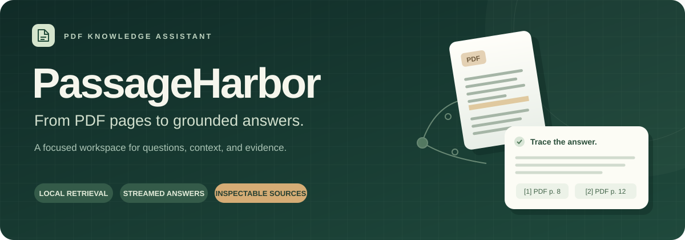
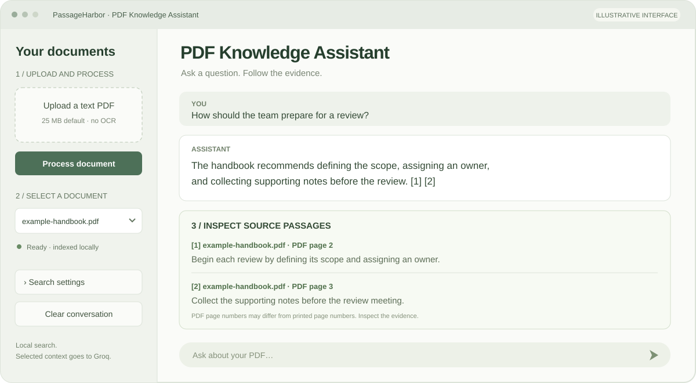
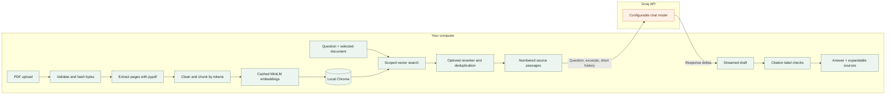

<p align="center">
  
</p>

<h1 align="center">PassageHarbor</h1>

<p align="center">
  <strong>A focused PDF knowledge assistant. Local retrieval. Streamed answers. Sources you can inspect.</strong>
</p>

<p align="center">
  <a href="https://github.com/hammadfarooq-ai/passageharbor/actions/workflows/ci.yml"></a>
  <a href="https://www.python.org/"></a>
  <a href="https://streamlit.io/"></a>
  <a href="https://www.trychroma.com/"></a>
  <a href="https://console.groq.com/docs/text-chat"></a>
  <a href="LICENSE"></a>
</p>

<p align="center">
  <a href="#quick-start">Quick start</a> ·
  <a href="#how-it-works">Architecture</a> ·
  <a href="docs/README.md">Documentation</a> ·
  <a href="docs/troubleshooting.md">Troubleshooting</a> ·
  <a href="CONTRIBUTING.md">Contributing</a>
</p>

---

PassageHarbor turns a text-based PDF into a small, searchable knowledge workspace. Upload a document, process it once, and ask questions in the **PDF Knowledge Assistant** chat interface. Each answer keeps its retrieved passages and PDF page labels beside it, so you can examine the evidence instead of losing it in a transient search result.

Built for one person running Python locally: four application modules, one Streamlit process, and an embedded Chroma database. No separate frontend, API server, authentication layer, LangChain, or Docker setup.

> [!IMPORTANT]
> **Local retrieval does not mean fully offline generation.** PDF extraction, embeddings, vector search, and optional reranking run on your machine. Answer generation sends your question, selected passages, filenames/page labels, and a short recent conversation to Groq. Follow-up rewriting may also send recent conversation. Without Groq configuration, local passage search still works. Read the [privacy guide](docs/privacy-and-security.md).

## What you can do

| Capability | What it means in practice |
| --- | --- |
| Upload and index | Process text PDFs up to 25 MB by default, with visible progress and actionable errors. |
| Reuse documents | SHA-256 byte identities prevent duplicate uploads; identical filenames do not merge different PDFs. |
| Chat with one document | Keep conversations separate for each selection, including follow-up questions. |
| Inspect the evidence | Expand numbered passages, PDF page labels, and original page text for new indexes. |
| Stream answers | Receive Groq response deltas, then check that numeric citation labels map to retrieved passages. |
| Improve retrieval | Optionally rerank about 15 candidates locally and retain 4–6 distinct passages. |
| Keep old data | Discover legacy `pdf_minilm_v1` records without deleting or migrating the existing database. |
| Search without a key | Use local retrieval while Groq credentials or a model selection are missing. |

<p align="center">
  
  <br>
  <sub>Interface guide, illustrated from the application's controls. Example content is synthetic; this is not a live model response or a screenshot.</sub>
</p>

## Quick start

### 1. Clone and install

Use Python **3.11 or newer**. Python 3.11–3.13 are the intended setup range; the local development environment used Windows/Python 3.13. Check the CI badge for the current hosted test result.

**Windows PowerShell**

```powershell
git clone https://github.com/hammadfarooq-ai/passageharbor.git
Set-Location passageharbor
python -m venv .venv
.\.venv\Scripts\Activate.ps1
python -m pip install --upgrade pip
python -m pip install -r requirements.txt
```

If PowerShell blocks activation, use `.\.venv\Scripts\python.exe` instead of `python` in the remaining commands. You do not need to change your execution policy. Existing local checkouts can start from their current directory, including `D:\rag-app`.

<details>
<summary><strong>macOS / Linux commands</strong></summary>

```bash
git clone https://github.com/hammadfarooq-ai/passageharbor.git
cd passageharbor
python3 -m venv .venv
source .venv/bin/activate
python -m pip install --upgrade pip
python -m pip install -r requirements.txt
cp .env.example .env
```

Edit `.env` with your preferred editor, then use the same Streamlit run command below. These are standard shell equivalents; they are not a claim that every platform/dependency combination has been manually tested.

</details>

### 2. Configure generation

```powershell
if (!(Test-Path .env)) { Copy-Item .env.example .env }
notepad .env
```

```dotenv
GROQ_API_KEY=your_groq_api_key
GROQ_MODEL=your_available_groq_chat_model_id
MAX_UPLOAD_MB=25
```

Create a key in the [Groq console](https://console.groq.com/keys) and choose a chat model from the [current supported models](https://console.groq.com/docs/models). There is no permanently hardcoded answer model. Keep the real key in `.env`; the example file intentionally contains no secret. Restart the app after changing configuration. Existing process environment variables take precedence over `.env`.

**Just exploring retrieval?** Leave the Groq fields blank and continue. The interface will show matching passages without generating an answer.

### 3. Start the application

```powershell
python -m streamlit run app.py
```

Open the local URL printed by Streamlit, normally **http://127.0.0.1:8501**. The included configuration binds the server to loopback. Run from the project directory to load its theme and server settings.

The first question or indexing operation loads `sentence-transformers/all-MiniLM-L6-v2`; the first use may download model files. The optional reranker downloads separately. Models are cached on disk by the underlying libraries and reused in memory across Streamlit reruns. See [setup and first-run downloads](docs/getting-started.md).

## Your first conversation

1. **Upload** a text-based PDF in the sidebar.
2. **Process document** and watch extraction, chunking, embeddings, and storage complete.
3. **Select** the ready document and ask a specific question.
4. **Inspect** the source passages below the response. Citation `[1]` refers to passage `[1]` in that answer's source list.
5. **Follow up** with a question such as “How can I apply that?” or switch to another document for a separate conversation.

Try questions such as:

- “What does the document recommend, and why?”
- “Which steps does it give for putting this idea into practice?”
- “What exceptions or limitations does the author mention?”

PDF page numbers are **one-based PDF pages**, which can differ from the printed page numbers in a book. Conversations live in the Streamlit session; indexes persist on disk. [Full user guide →](docs/user-guide.md)

## How it works



Follow-ups can first use Groq to rewrite the latest question for retrieval. The original question is retained for generation. Previous assistant messages help interpret the conversation and are explicitly **not** source evidence.

The pipeline preserves original extracted page text, prefers tokenizer character offsets for displayed excerpts, and checks every embedded span against the model's input limit including special tokens. Incomplete indexes stay out of normal search until all writes and the count check finish. Read the [architecture](docs/architecture.md) and [storage specification](docs/storage-and-migration.md) for the exact behavior.

## Configuration at a glance

| Setting | Default | Purpose |
| --- | --- | --- |
| `GROQ_API_KEY` | Empty | Enables authenticated generation when a model is also configured. |
| `GROQ_MODEL` | Empty | Selects an available Groq chat model. |
| `MAX_UPLOAD_MB` | `25` | Positive integer upload limit enforced before processing. |
| Improve passage ranking | Off | Optional local CPU cross-encoder reranking. |
| Candidate passages | `15` | Sidebar range: 10–30. |
| Passages per answer | `5` | Sidebar range: 4–6; deduplication may return fewer. |

Raising the app limit also requires a compatible Streamlit transport limit, for example:

```powershell
# Set MAX_UPLOAD_MB=50 in .env first.
python -m streamlit run app.py --server.maxUploadSize 50
```

Chunk size, model names, batch sizes, and Groq request limits are code constants rather than additional environment variables. [Complete configuration reference →](docs/configuration.md)

## Existing CLI workflows

The original extraction, indexing, and search commands remain available:

```powershell
python pdf_reader.py "my-document.pdf" --output-dir output_text
python vector_store.py index --folder output_text --source "my-document.pdf"
python vector_store.py search "What does the document recommend?"
python vector_store.py search "What are the practical steps?" --source "my-document.pdf" --top-k 5
```

CLI search without a filter searches all ready documents. The UI always scopes retrieval to the selected document. Use `--document-id` for an unambiguous CLI selection when different versions share a filename. Extract each PDF into a separate page-text folder to avoid stale files from earlier extractions. [CLI reference →](docs/cli-reference.md)

## Storage and backward compatibility

```text
passageharbor/
├── app.py                  # Streamlit UI and per-document session history
├── pdf_reader.py           # PDF validation and original page extraction
├── vector_store.py         # Chunking, local models, Chroma, and CLI
├── rag.py                  # Retrieval, Groq streaming, and citation checks
├── tests/                  # Temporary stores and mocked generation
├── docs/                   # Guides, architecture, reference, and visuals
├── .github/                # CI and contribution templates
├── .streamlit/config.toml  # Neutral theme and local server settings
├── .env.example            # Public configuration template
├── chroma_db/              # Local vectors; ignored by Git
└── documents/<sha256>/     # PDF, original pages, manifest; ignored by Git
```

- **Legacy:** `pdf_minilm_v1` records are discovered through `source` metadata and remain searchable. The app never rewrites that collection.
- **New indexes:** `pdf_minilm_v2` adds document identity, schema metadata, stable chunk IDs, and ready-state tracking in a local manifest.
- **Duplicate handling:** the same PDF bytes reuse their index; a different PDF with the same filename remains separate.
- **Public source only:** PDFs, generated page text, databases, virtual environments, and `.env` are excluded from this repository. A fresh clone starts without documents.

Back up `chroma_db/` and `documents/` together while the app is stopped. No reindex is required merely to start the UI with a compatible legacy database. [Data formats, migration, and backup →](docs/storage-and-migration.md)

## Reliability and boundaries

> [!NOTE]
> **Citations are inspectable references, not a proof of correctness.** Valid labels establish a mapping to retrieved passages. They do not prove that every claim is supported. Missing or invalid labels produce a visible verification warning; interrupted streams remain incomplete drafts.

- **No OCR.** Scanned-only PDFs require a separate OCR step. Mixed documents may contain unindexed images, and PDF extraction can lose complex table or reading-order information.
- **Approximate retrieval.** Broad questions can miss relevant content. This is passage-based QA, not exhaustive full-document summarization.
- **One local user.** Document scoping is a retrieval boundary, not authentication or tenant isolation. Do not expose this app to the public internet as-is.
- **No confidence percentages.** Vector distances and reranker scores are ranking signals. No universal relevance threshold is assumed.
- **External generation.** Model availability, context limits, provider rate limits, and network access still apply. Errors preserve access to retrieved sources.

See [troubleshooting](docs/troubleshooting.md) for credential/model errors, timeouts, download problems, interrupted indexing, and storage recovery.

## Development and verification

```powershell
python -m pip install -r requirements-dev.txt
python -m pytest -q
python -m compileall -q app.py pdf_reader.py vector_store.py rag.py
python scripts/check_docs.py
```

Tests use temporary databases, deterministic fake embeddings, and mocked Groq responses, including the installed SDK's streaming types through a mock HTTP transport. They do not use your `.env` to make generation requests or alter the real index. The CI workflow runs these checks on Linux/Python 3.11 and Windows/Python 3.13. Model downloads and live Groq generation are separate manual checks, not claims made by the unit suite.

[Testing guide](docs/testing.md) · [Module reference](docs/developer-reference.md) · [Contributing](CONTRIBUTING.md) · [Changelog](CHANGELOG.md)

## Documentation library

- [Start here](docs/README.md) — role-based reading paths and terminology.
- [Getting started](docs/getting-started.md) — installation, first run, and environment setup.
- [User guide](docs/user-guide.md) — processing, conversation, sources, and retrieval controls.
- [Architecture](docs/architecture.md) — component, sequence, and processing-state diagrams.
- [Configuration](docs/configuration.md) — environment variables, constants, and provider behavior.
- [Storage and migration](docs/storage-and-migration.md) — identities, schemas, legacy data, and backup.
- [CLI reference](docs/cli-reference.md) — arguments, examples, and scope differences.
- [Developer reference](docs/developer-reference.md) — Python functions, records, and extension points.
- [Testing](docs/testing.md) — what is tested, manual checks, and limits of the evidence.
- [Privacy and security](docs/privacy-and-security.md) — data boundaries and safe local operation.
- [Troubleshooting](docs/troubleshooting.md) — symptoms, causes, and practical recovery steps.

## License and acknowledgments

Released under the [MIT License](LICENSE). Built with [Streamlit](https://streamlit.io/), [Chroma](https://www.trychroma.com/), [Sentence Transformers](https://sbert.net/), [pypdf](https://pypdf.readthedocs.io/), [Groq](https://console.groq.com/docs/), and [python-dotenv](https://bbc2.github.io/python-dotenv/). Their software, hosted services, and model weights retain their own licenses and terms. Uploaded PDFs are not distributed with this project.
