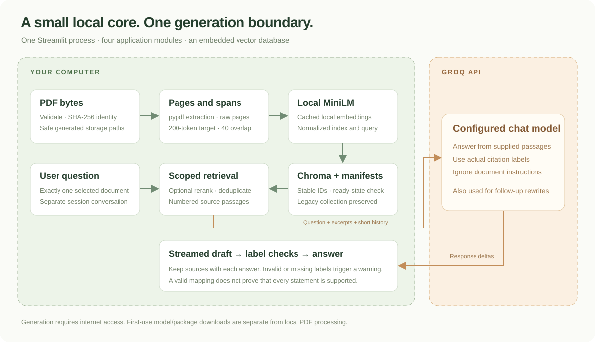
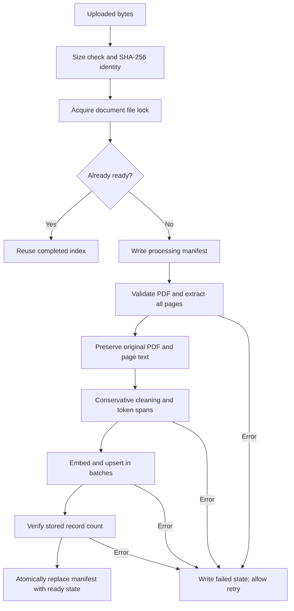
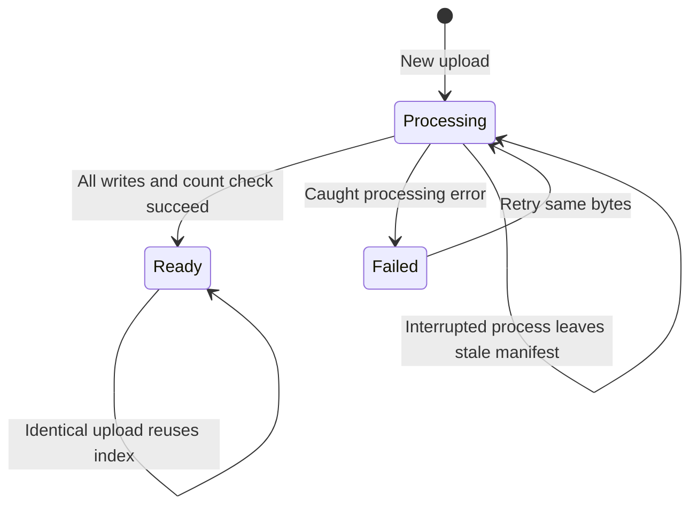
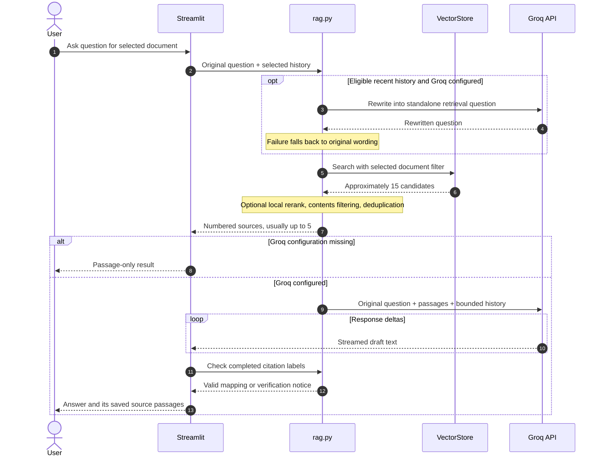

# Architecture

[Documentation home](README.md) · [Storage specification](storage-and-migration.md) · [Developer reference](developer-reference.md)

## Design scope

PassageHarbor is a single-user Python application. Streamlit hosts the UI, a Chroma persistent client stores vectors in-process, and Sentence Transformers computes local embeddings. Groq is the only generation provider implemented. There is no separately deployed backend, job queue, browser frontend build, or orchestration framework.

The local boundary includes both uploaded PDF data and persisted embeddings. The external generation boundary includes retrieved text and a bounded conversation envelope. Model installation/downloads are an additional external interaction with package/model hosts; they do not make extraction itself a hosted operation.

## Module responsibilities

- **`app.py`** owns sidebar controls, status rendering, chat messages, Streamlit resource caching, per-document conversations, and saved source mappings.
- **`pdf_reader.py`** validates bytes and extracts a `Page(number, text)` for every PDF page. Its CLI preserves the original page-file workflow.
- **`vector_store.py`** owns text normalization, conservative cleaning, token-aware spans, model caches, document identities, manifests, locks, Chroma persistence, legacy discovery, and CLI search.
- **`rag.py`** owns environment loading, optional question rewriting, final passage selection, context assembly, Groq streaming/error translation, and citation-label validation.

Imports remain one-directional: PDF extraction does not import vector storage; vector storage does not import generation; generation imports vector helpers; the UI composes them.

## Indexing lifecycle

The PDF-byte hash is independent of the filename. The first successful upload's sanitized display filename is retained for later identical uploads. Stable chunk IDs combine schema version, identity, PDF page, and chunk number. On retry, only the incomplete v2 document's own records are replaced.

The ready marker is an atomic replacement of a local JSON manifest after batch writes and a count check. It is **not** a distributed transaction between Chroma and the filesystem. A crash before readiness can leave partial chunks, but those records do not appear through normal new-document retrieval. A later retry clears/rebuilds that identity. Backups therefore need both storage directories together.

`Document.status` also defaults to `pending` for programmatic construction. The UI's normal upload workflow persists `processing`, `failed`, and `ready`. A stale processing manifest is retryable after its process lock is released. File existence alone does not mean a lock is held.

## Chunking and cleaning

1. Normalize line endings and horizontal whitespace conservatively; retain line structure, punctuation, and case.
2. Count exact case-folded short lines in the first/last three nonempty lines of pages. A marginal line must repeat on at least `max(3, ceil(nonempty_pages × 0.45))` pages before removal is considered.
3. Remove matching repeated lines only at page margins. If that would erase all alphanumeric content of a page, retain the normalized page instead. Original extracted pages remain unchanged on disk.
4. Tokenize each whole normalized page without truncation and with `verbose=False` for these intentional full-page calls. Unrelated warnings are not globally hidden.
5. Prefer fast-tokenizer offsets to slice original text spans. A slow-tokenizer fallback decodes token windows when offsets are unavailable.
6. Target 200 content tokens with 40-token overlap. Use the lower of the model's actual sequence limit and tokenizer limit, reserve special-token space, and retokenize each final span to check it fits.

Every chunk belongs to one PDF page. Overlap occurs within a page; chunks do not merge multiple pages. Cleaned-text offsets locate spans in the normalized/cleaned page, not byte offsets in the PDF or offsets into raw extracted text.

## Question-answer sequence

New-document search checks its manifest is currently ready before querying `pdf_minilm_v2` with `document_id`. Legacy search queries `pdf_minilm_v1` with its exact `source` value. In the UI there is always one selected document. The compatibility CLI can intentionally search all ready documents.

## Ranking and source selection

Vector search uses the same normalized MiniLM embedding settings as indexing and a cosine-space collection. The optional cached cross-encoder runs on CPU and sorts candidates against the retrieval question. Initialization or prediction failure returns to vector ordering with a notice.

Contents-like passages are removed when other useful candidates exist, except for explicit contents questions. Deduplication considers same-page character overlap of at least 65% of the shorter span, or token-set similarity/equality. These cutoffs are duplication heuristics, not semantic confidence thresholds. The default final target is five passages; fewer can survive the filters.

## Conversation and evidence boundaries

`st.session_state.conversations` is keyed by selected identity. Generation and rewriting only receive that selected list. `recent_history()` keeps at most six eligible user/assistant messages, each capped at 1,800 characters; failed, unverified, and retrieval-only assistant entries are excluded. This caps messages and text, not exact provider tokens.

Generation receives a JSON data envelope containing the original question, bounded conversation marked as not evidence, and numbered passages. System instructions require source-grounded claims, actual labels, no invented quotations/page numbers, and ignoring instructions inside documents. No tool execution is attached to document content.

## Completion and failure behavior

Groq uses a 45-second SDK timeout, no automatic retries, and streaming response deltas for generation. Empty content and output-length completion are treated as failures. Authentication, rate-limit, model/request, timeout, and connection failures are translated into safe user-facing messages without echoing provider bodies.

Citation checks accept the exact insufficient-information sentence or require numeric labels mapped to available passages. They flag numeric grouped/ranged labels as malformed under this implementation. They do not perform entailment checking, evaluate factual truth, or prove that all claims cite the right evidence. The source list persists with each answer rather than being recomputed on rerun.

## Deliberate tradeoffs

The small-file design favors local understandability over background-worker concurrency or hosted multi-tenant operation. Manifest discovery scans local files; legacy discovery reads metadata in pages of 1,000 records. This is appropriate for a small local library, not a benchmarked large-corpus catalog. The UI keeps chat history in memory and offers no durable export or document-deletion control. These boundaries are documented rather than hidden behind unsupported feature claims.
